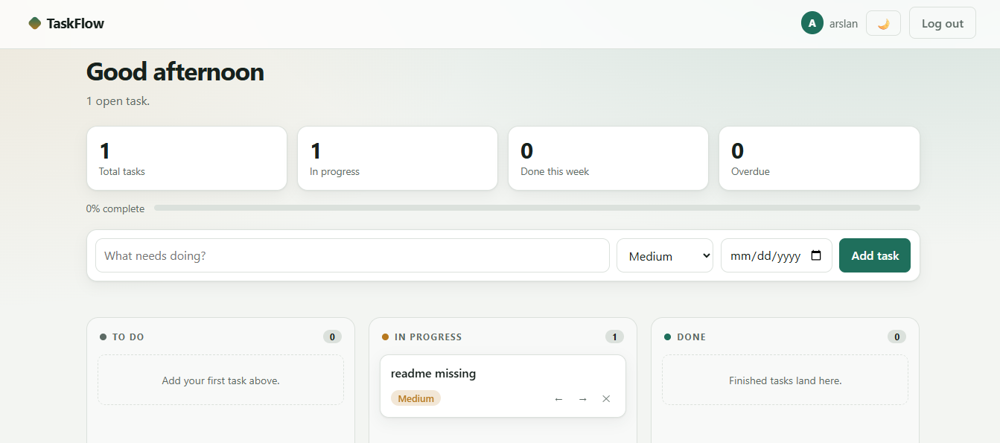
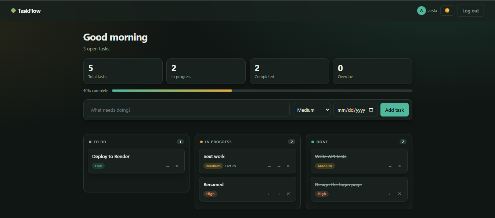

# TaskFlow


A lightweight kanban task manager built with Django. Add tasks, drag them across columns, and track progress at a glance.

**Live demo:** https://taskflow1-six.vercel.app

| Light | Dark |
|---|---|
|  |  |

## Features
- Sign up, log in and log out, with each user seeing only their own tasks
- Kanban board with drag-and-drop, plus arrow buttons for touch and keyboard use
- Priorities, due dates and an overdue indicator
- Summary stats: total, in progress, done this week, overdue, and a progress bar
- Light and dark mode with a saved preference
- JSON REST API with server-side validation
- Automated tests and GitHub Actions CI

## Tech stack
Python · Django 5 · PostgreSQL (SQLite locally) · Vanilla JavaScript · WhiteNoise · Gunicorn · Docker · GitHub Actions · Vercel

## Run locally
```bash
git clone https://github.com/Arslan3x5/taskflow.git
cd taskflow
python -m venv .venv
source .venv/bin/activate        # Windows: .venv\Scripts\activate
pip install -r requirements.txt
python manage.py migrate
python manage.py runserver
```
Open http://127.0.0.1:8000 and create an account.

Run the tests with `python manage.py test`.

## Configuration
Settings are read from environment variables (see `.env.example`):

| Variable | Purpose |
|---|---|
| `SECRET_KEY` | Django secret key |
| `DEBUG` | `1` for development, `0` for production |
| `ALLOWED_HOSTS` | Comma-separated hostnames |
| `CSRF_TRUSTED_ORIGINS` | Comma-separated origins, e.g. `https://*.vercel.app` |
| `DATABASE_URL` | PostgreSQL connection string (SQLite is used if unset) |

## API (login required)
| Method | Endpoint | Purpose |
|---|---|---|
| GET, POST | `/api/tasks/` | List or create tasks |
| PATCH, DELETE | `/api/tasks/<id>/` | Update or delete a task |
| GET | `/api/stats/` | Dashboard counts |

## Design decisions
- **No frontend build step.** One template with vanilla JavaScript keeps the app small and fast to load.
- **User isolation.** Every query is scoped to the logged-in user, and a test covers it.
- **Server-side validation** on every field.
- **Stats computed on the server**, so "done this week" is accurate.

## Roadmap
- [ ] Team workspaces and task assignment
- [ ] Email reminders for due dates
- [ ] Search and filters

## License
MIT